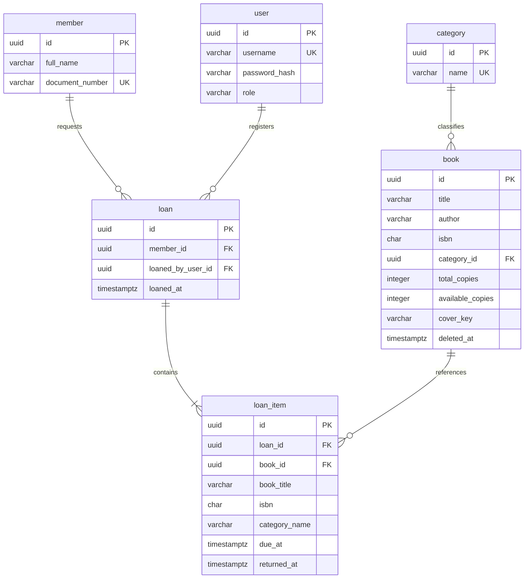

# Data Model

## 1. Overview

The Manager Library system uses a relational data model to manage library resources, members, users, loans, and loan items.

The database is designed for PostgreSQL 16 and uses the `library` schema.

The model consists of six main entities:

- `category`
- `book`
- `member`
- `user`
- `loan`
- `loan_item`

This document describes the logical and physical organization of the database according to the central project specification.

## 2. Database Configuration

| Property | Value |
|---|---|
| Database Engine | PostgreSQL 16 |
| Schema | `library` |
| Naming Convention | `snake_case` |
| Table Names | Singular and written in English |
| Primary Keys | UUID |
| Timestamp Type | `timestamptz` |
| Server Time Zone | UTC |

All database tables use singular names and English identifiers.

## 3. Main Entities

### 3.1 Category

The `category` entity stores the predefined categories used to classify books.

| Attribute | Data Type | Nullable | Description |
|---|---|---|---|
| `id` | UUID | No | Primary key. |
| `name` | VARCHAR(120) | No | Unique category name. |

Categories are predefined and initialized with five fixed records. They do not have general maintenance operations.

### 3.2 Book

The `book` entity stores information about the books available in the library.

| Attribute | Data Type | Nullable | Description |
|---|---|---|---|
| `id` | UUID | No | Primary key. |
| `title` | VARCHAR(250) | No | Book title. |
| `author` | VARCHAR(200) | No | Book author. |
| `isbn` | CHAR(13) | No | Unique ISBN among active books. |
| `category_id` | UUID | No | Reference to the book category. |
| `total_copies` | INTEGER | No | Total number of copies. |
| `available_copies` | INTEGER | No | Number of available copies. |
| `cover_key` | VARCHAR(512) | Yes | Opaque reference to the cover image. |
| `deleted_at` | TIMESTAMPTZ | Yes | Logical deletion timestamp. |

Business constraints:

- ISBN must contain exactly 13 digits.
- ISBN must be unique among active books.
- Total copies must be at least one.
- Available copies must be between zero and total copies.
- Book deletion must be logical.
- Cover images must be JPG or PNG and cannot exceed 2 MB.

### 3.3 Member

The `member` entity stores information about people who borrow books.

| Attribute | Data Type | Nullable | Description |
|---|---|---|---|
| `id` | UUID | No | Primary key. |
| `full_name` | VARCHAR(200) | No | Member's full name. |
| `document_number` | VARCHAR(30) | No | Unique identification number. |

Members do not authenticate directly into the application.

### 3.4 User

The `user` entity stores accounts belonging to internal library operators.

| Attribute | Data Type | Nullable | Description |
|---|---|---|---|
| `id` | UUID | No | Primary key. |
| `username` | VARCHAR(120) | No | Unique username. |
| `password_hash` | VARCHAR(512) | No | Hashed password. |
| `role` | VARCHAR(40) | No | User role. |

Supported roles:

- `admin`
- `librarian`

Passwords must never be stored as plain text.

### 3.5 Loan

The `loan` entity represents a borrowing operation registered by an authorized library operator.

| Attribute | Data Type | Nullable | Description |
|---|---|---|---|
| `id` | UUID | No | Primary key. |
| `member_id` | UUID | No | Reference to the borrowing member. |
| `loaned_by_user_id` | UUID | No | Reference to the user who registered the loan. |
| `loaned_at` | TIMESTAMPTZ | No | Date and time of the loan. |

A loan groups one or more loan items and preserves information about who borrowed the books and who registered the operation.

### 3.6 Loan Item

The `loan_item` entity represents an individual book included in a loan.

| Attribute | Data Type | Nullable | Description |
|---|---|---|---|
| `id` | UUID | No | Primary key. |
| `loan_id` | UUID | No | Reference to the associated loan. |
| `book_id` | UUID | No | Reference to the borrowed book. |
| `book_title` | VARCHAR(250) | No | Historical copy of the book title. |
| `isbn` | CHAR(13) | No | Historical copy of the ISBN. |
| `category_name` | VARCHAR(120) | No | Historical copy of the category name. |
| `due_at` | TIMESTAMPTZ | No | Loan due date. |
| `returned_at` | TIMESTAMPTZ | Yes | Date and time of the return. |

The title, ISBN, and category name are snapshots of the book information at the time of the loan. They preserve historical information even if the book catalog changes.

The due date is calculated as 14 days after the loan registration date.

## 4. Entity Relationships

The database defines the following relationships:

| Relationship | Cardinality | Description |
|---|---|---|
| Category - Book | One-to-Many | A category can classify multiple books. |
| Member - Loan | One-to-Many | A member can have multiple loans. |
| User - Loan | One-to-Many | A user can register multiple loans. |
| Loan - Loan Item | One-to-Many | A loan contains one or more items. |
| Book - Loan Item | One-to-Many | A book can appear in multiple historical loan items. |

### 4.1 Entity Relationship Diagram

## 5. Database Constraints and Integrity

The database must enforce the following constraints:

| Rule | Entity | Constraint |
|---|---|---|
| Unique category name | `category` | Unique index. |
| Unique member document number | `member` | Unique index. |
| Unique username | `user` | Unique index. |
| Unique ISBN among active books | `book` | Partial unique index. |
| Available copies cannot exceed total copies | `book` | Check constraint. |
| Total copies must be positive | `book` | Domain validation; database constraint pending T-18. |
| User role must be valid | `user` | Domain validation; database constraint pending T-18. |
| A book cannot appear twice in one loan | `loan_item` | Unique constraint on `(loan_id, book_id)`. |

Foreign key relationships must preserve historical information and prevent invalid references.

## 6. Loan Status

Loan status is calculated and is not stored as a database column.

The possible statuses are:

| Status | Condition |
|---|---|
| `open` | The loan has outstanding items and has not passed its due date. |
| `overdue` | The loan has outstanding items and the due date has passed. |
| `closed` | All loan items have been returned. |

## 7. Data Integrity and Transactions

The backend must preserve database consistency when processing loans and returns.

The following requirements apply:

- Loan creation and book availability updates must occur within the same database transaction.
- If loan registration fails, the transaction must be rolled back.
- Each loan item must belong to an existing loan and book.
- A loan item cannot be returned more than once.
- Book availability must be updated when an item is returned.
- Historical loan records must be preserved.

## 8. Referential Integrity and Deletion Policies

The database uses foreign key restrictions to protect historical information.

| Relationship | Deletion Policy | Purpose |
|---|---|---|
| `book.category_id` | RESTRICT | Prevents deleting a category referenced by books. |
| `loan.member_id` | RESTRICT | Preserves member references in historical loans. |
| `loan.loaned_by_user_id` | RESTRICT | Preserves the identity of the user who registered a loan. |
| `loan_item.loan_id` | CASCADE | Defines loan item dependency on its loan. |
| `loan_item.book_id` | RESTRICT | Prevents deleting books referenced by historical loan items. |

Books use logical deletion through `deleted_at`.

Loans and loan items must not be physically deleted as part of normal application operations.

## 9. Data Privacy and Retention

The database contains personal and operational information.

The following requirements apply:

- User passwords must be stored as hashes.
- Password hashes must never appear in API responses or application logs.
- Member personal information must be accessible only to authorized administrators and librarians.
- Reports must not expose member or librarian personal information.
- Loan and loan item historical records must be retained.
- Book cover files may be physically removed only according to the specified cover deletion procedure.

## 10. Predefined Categories

The system initializes five predefined categories:

| ID | Category |
|---|---|
| `11111111-1111-4111-8111-111111111111` | Novela |
| `22222222-2222-4222-8222-222222222222` | Ciencia |
| `33333333-3333-4333-8333-333333333333` | Tecnología |
| `44444444-4444-4444-8444-444444444444` | Historia |
| `55555555-5555-4555-8555-555555555555` | Infantil |

These categories are predefined reference data and are not maintained through general category management operations.

## 11. Reference Specification

This document follows the official Manager Library data model defined in the central documentation repository.

The original specification is the authoritative source for database attributes, data types, relationships, constraints, and retention policies.

Any change to the database model must remain consistent with that specification.